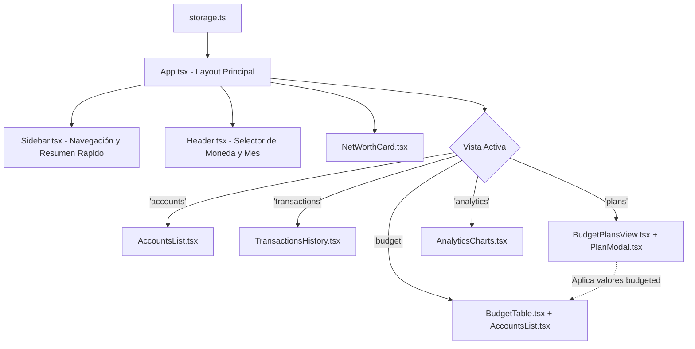
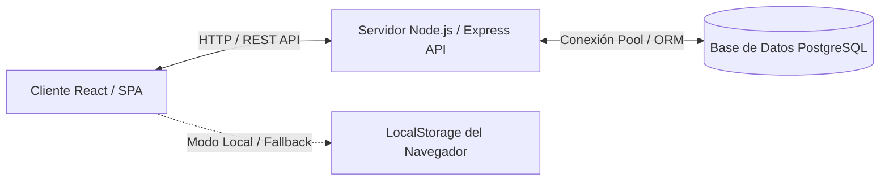

# Design: Sidebar y Planes de Presupuesto

## Arquitectura y Componentes



## Modelos de Datos (TypeScript en Inglés)

### 1. `BudgetPlan`
```typescript
export interface BudgetPlan {
  id: string;
  name: string;
  description?: string;
  targetMonthlyIncome: number;
  allocations: Record<string, number>; // categoryId -> target amount
  isDefault?: boolean;
  createdAt: string;
  updatedAt: string;
}
```

### 2. Extensión de `AppState`
```typescript
export interface AppState {
  accounts: Account[];
  categoryGroups: CategoryGroup[];
  categories: Category[];
  transactions: Transaction[];
  budgetPlans: BudgetPlan[];
  activePlanId?: string;
  currencyConfig: CurrencyConfig;
  selectedMonth: string; // YYYY-MM
}
```

## Reglas de Interacción
1. **Idioma:**
   - Textos de interfaz, alertas, modales y documentación: **Español**.
   - Nombres de componentes, interfaces, funciones, variables y métodos: **Inglés**.
2. **Aplicar Plan:**
   - Cuando el usuario hace clic en "Aplicar Plan", las categorías activas reciben en `budgeted` el monto asignado en dicho plan para la moneda base.

## Arquitectura de Persistencia con PostgreSQL (Fase Backend)

Para la siguiente fase de integración cliente-servidor con base de datos relacional PostgreSQL:



### Esquema Relacional en PostgreSQL

```sql
-- Cuentas Financieras
CREATE TABLE accounts (
    id VARCHAR(50) PRIMARY KEY,
    name VARCHAR(100) NOT NULL,
    type VARCHAR(20) NOT NULL CHECK (type IN ('cash', 'bank', 'savings', 'credit')),
    initial_balance NUMERIC(14, 2) NOT NULL DEFAULT 0.00,
    current_balance NUMERIC(14, 2) NOT NULL DEFAULT 0.00,
    currency VARCHAR(10) NOT NULL DEFAULT 'USD',
    color VARCHAR(20),
    created_at TIMESTAMP WITH TIME ZONE DEFAULT NOW()
);

-- Grupos de Categorías
CREATE TABLE category_groups (
    id VARCHAR(50) PRIMARY KEY,
    name VARCHAR(100) NOT NULL,
    color VARCHAR(20)
);

-- Categorías de Presupuesto
CREATE TABLE categories (
    id VARCHAR(50) PRIMARY KEY,
    group_id VARCHAR(50) REFERENCES category_groups(id) ON DELETE CASCADE,
    name VARCHAR(100) NOT NULL,
    budgeted NUMERIC(14, 2) NOT NULL DEFAULT 0.00,
    target_amount NUMERIC(14, 2),
    icon VARCHAR(50),
    color VARCHAR(20)
);

-- Transacciones (Ingresos, Gastos, Transferencias)
CREATE TABLE transactions (
    id VARCHAR(50) PRIMARY KEY,
    date DATE NOT NULL,
    type VARCHAR(20) NOT NULL CHECK (type IN ('income', 'expense', 'transfer')),
    amount NUMERIC(14, 2) NOT NULL,
    currency VARCHAR(10) NOT NULL,
    account_id VARCHAR(50) NOT NULL REFERENCES accounts(id) ON DELETE CASCADE,
    target_account_id VARCHAR(50) REFERENCES accounts(id) ON DELETE SET NULL,
    category_id VARCHAR(50) REFERENCES categories(id) ON DELETE SET NULL,
    payee_or_source VARCHAR(150) NOT NULL,
    notes TEXT,
    created_at TIMESTAMP WITH TIME ZONE DEFAULT NOW()
);

-- Planes de Presupuesto (YNAB Plans)
CREATE TABLE budget_plans (
    id VARCHAR(50) PRIMARY KEY,
    name VARCHAR(100) NOT NULL,
    description TEXT,
    target_monthly_income NUMERIC(14, 2) NOT NULL DEFAULT 0.00,
    allocations JSONB NOT NULL DEFAULT '{}'::jsonb,
    is_default BOOLEAN DEFAULT FALSE,
    created_at TIMESTAMP WITH TIME ZONE DEFAULT NOW(),
    updated_at TIMESTAMP WITH TIME ZONE DEFAULT NOW()
);
```

