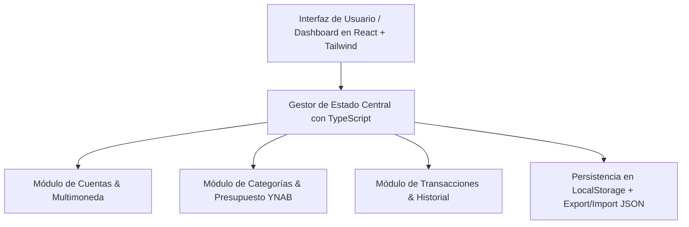

## Arquitectura del Sistema y Stack Tecnológico

### Stack Tecnológico y Librerías
- **Frontend Core:** React + TypeScript con Vite (construcción rápida y tipado seguro).
- **Estilos y UI:** TailwindCSS (diseño responsivo, modo oscuro/claro y componentes limpios).
- **Iconografía:** `lucide-react` (íconos para cuentas, transacciones y categorías).
- **Gráficos:** `recharts` / `chart.js` (análisis visual de gastos e ingresos).
- **Base de Datos / Persistencia:** `localStorage` nativo con sincronización de estado y utilidades de importación/exportación JSON.
- **Manejo de Fechas y Formatos:** API nativa `Intl.NumberFormat` y `Intl.DateTimeFormat` para formateo según la moneda seleccionada.



## Modelos de Datos

### 1. Cuenta (`Account`)
```typescript
interface Account {
  id: string;
  name: string;
  type: 'checking' | 'savings' | 'cash' | 'credit';
  initialBalance: number;
  currentBalance: number;
  currency: string; // ej: 'USD', 'BOB', 'EUR'
  color?: string;
}
```

### 2. Categoría y Grupo (`CategoryGroup` y `Category`)
```typescript
interface CategoryGroup {
  id: string;
  name: string; // ej: "Gastos Fijos", "Gastos Diarios", "Ahorros"
  categories: Category[];
}

interface Category {
  id: string;
  name: string;
  budgeted: number; // Monto asignado para el mes
  spent: number;    // Calculado a partir de transacciones
  icon?: string;
}
```

### 3. Transacción (`Transaction`)
```typescript
interface Transaction {
  id: string;
  date: string; // ISO format YYYY-MM-DD
  type: 'income' | 'expense' | 'transfer';
  amount: number;
  currency: string;
  accountId: string;          // Cuenta origen o receptora
  targetAccountId?: string;    // En caso de transferencia
  categoryId?: string;        // Categoría asignada
  payeeOrSource: string;       // Comercio o fuente
  notes?: string;
}
```

### 4. Configuración y Monedas (`CurrencyConfig`)
```typescript
interface CurrencyConfig {
  baseCurrency: string; // ej: 'USD'
  selectedCurrency: string; // ej: 'BOB'
  exchangeRates: {
    [key: string]: number; // ej: { 'USD': 1.0, 'BOB': 6.96, 'EUR': 0.92 }
  };
}
```

## Principales Flujos de Usuario
1. **Flujo de Asignación (Presupuesto Base Cero):**
   - El sistema calcula: `Disponible = Total Ingresos en Cuentas - Total Presupuestado en Categorías`.
   - El usuario distribuye el dinero disponible entre las categorías hasta llegar a $0 disponibles (cada centavo tiene un propósito, regla clave de YNAB).
2. **Flujo de Transacción:**
   - Al registrar un gasto en una categoría, se resta del saldo de la cuenta elegida y del monto presupuestado disponible en dicha categoría.
3. **Flujo de Cambio de Moneda:**
   - Un selector global en la barra superior permite cambiar la moneda activa en cualquier momento, aplicando la tasa de conversión en tiempo real en todos los componentes.

## Diseño Visual y Experiencia de Usuario (UI/UX)
- **Tema:** Interfaz moderna y limpia con soporte para tema oscuro/claro y colores contrastantes para saldos positivos (verde) y sobregiros (rojo).
- **Dashboard:**
  - Tarjetas superiores de resumen: Patrimonio Neto, Dinero para Presupuestar, Gasto del Mes.
  - Barra lateral: Listado de cuentas con sus saldos.
  - Panel central: Tabla interactiva de categorías con barras de progreso de gasto.
  - Panel inferior/pestaña: Historial de transacciones con filtros rápidos.
